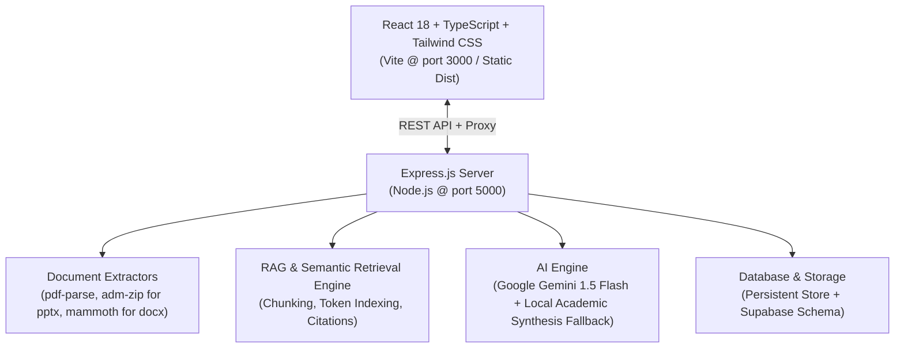

# Vantage MBA – Strategic AI-Powered Learning Intelligence Platform

> **A student-centric academic intelligence companion designed specifically for MBA scholars to make their coursework smarter, easier, and more productive.**  
> *Upload once, understand better, practice regularly, and revise faster.*

---

## 🌟 Key Capabilities & Differentiating Features

- **Dedicated Student Authentication**: Direct portal login personalized for **Mahak** (`MBA Scholar • Tech Product & Strategic Management`).
- **Zero Clutter, Executive Interface**: Clean, distraction-free workspace with seamless Light / Dark mode support.
- **Multi-Format Document Ingestion**: Drag & drop support for **PDF**, **PPTX** (processed slide by slide), **DOCX**, and **TXT** files.
- **RAG & Semantic Retrieval**: Text chunking, token indexing, and semantic retrieval with slide and page citation tracking.
- **AI Notes Generator**:
  - **Complete Notes**: Deep topic breakdowns, MBA business examples, formulas, calculations, and tables.
  - **Short Notes**: High-yield definitions, main takeaways, and key formulas.
  - **Revision Notes**: 5-minute pre-exam cheat sheets and comparison matrices.
  - **Exam-Oriented Notes**: Short and long analytical examination questions with model grading rubrics.
  - *All notes feature Markdown editing, auto-save, search, and one-click PDF export!*
- **Spaced Repetition Flashcards**:
  - 3D active recall flip cards with rating intervals (**Hard**, **Good**, **Easy**).
  - Deck shuffling, manual card creation, and missed cards filter.
- **Practice Questions & MCQ Bank**:
  - Multiple Choice, True/False, Case-Based, and Numerical problems.
  - Real-time evaluation revealing correct answers, detailed explanations, and **distractor rationale** (why each wrong choice is incorrect).
- **Interactive Timed Quizzes & Mock Exams**:
  - Live countdown clock, question navigator, and instant grading.
  - Comprehensive performance report: overall percentage, topic-by-topic analytics, and tailored revision recommendations.
- **AI Academic Mentor**:
  - Conversational tutor tailored to each subject with RAG citations linking directly to your uploaded lecture slides and textbook passages.
  - Quick action prompt chips: *"Explain Simply"*, *"Give a Real-Life Business Example"*, *"Explain Step by Step"*, *"From Uploaded PPT"*, *"Compare Two Concepts"*.
- **Visual Learning Studio**:
  - **Interactive Flowcharts**: Clickable end-to-end stages with KPIs, inputs, failure traps, and case studies.
  - **Concept Maps**: Interconnected knowledge graphs showing strategic relationships.
  - **Animated Equilibrium Dynamics**: Interactive supply and demand curves with live price sliders and market shock toggles.
  - **Business Simulations**: Real-time pricing, margin, revenue, and marketing spend elasticity simulator.
  - **Visual Comparisons**: Structured comparison matrices (e.g. Agile vs Waterfall).
  - **Executive Case Storytelling**: Real-world strategic dilemmas, decisions, and takeaways.
- **Smart Revision Centre**:
  - Algorithmic daily revision queue combining spaced repetition cards due and weak topics flagged from quiz errors.
- **Academic Calendar**:
  - Visual organizer for examinations, assignment deadlines, presentations, and daily study planning.

---

## 🛠️ Architecture & Tech Stack



- **Frontend**: React 18, TypeScript, Tailwind CSS, Lucide Icons, jsPDF, marked, canvas-confetti.
- **Backend**: Express.js, Multer, `pdf-parse`, `mammoth` (DOCX), `adm-zip` (PPTX slide-by-slide XML parsing), `@google/generative-ai`.
- **Hybrid AI Engine**: Operates with Google Gemini API when configured, and features a built-in Local Academic Synthesis & RAG heuristic engine so the entire platform works out of the box even without an external API key!
- **Database**: Persistent JSON store with full CRUD repository layer, plus a complete production-grade Supabase PostgreSQL schema with Row-Level Security policies (`server/supabase_schema.sql`).

---

## 🚀 Quick Start Guide

### 1. Install Dependencies
```bash
# In the root repository directory:
npm install
npm --prefix client install
npm --prefix server install
```

### 2. Build & Run Application
```bash
# Build frontend
npm run build

# Start production server
npm start
```
- Open [http://localhost:5000](http://localhost:5000) in your browser.

For local development with hot reload:
```bash
npm run dev
```

---

## ☁️ Deployment Instructions

### Deploy to Render / Railway / Heroku

1. **Push code to your GitHub repository**:
   ```bash
   git remote add origin https://github.com/Mahak-tech/Vantage-MBA.git
   git branch -M main
   git push -u origin main
   ```
2. **Deploy on Render (Web Service)**:
   - Connect your GitHub repo `Mahak-tech/Vantage-MBA`.
   - **Environment**: `Node`
   - **Build Command**: `npm run build`
   - **Start Command**: `npm start`
   - **Port**: Handled automatically via `process.env.PORT`.
3. **Deploy on Railway**:
   - New Project → Deploy from GitHub repo → `Vantage-MBA`.
   - Railway will auto-detect Node.js, run `npm run build`, and execute `npm start`.

---

## 🔑 AI & Cloud Configuration

### Google Gemini API (Optional for Enhanced LLM Synthesis)
1. Get a free API key from [Google AI Studio](https://aistudio.google.com/app/apikey).
2. In Vantage MBA, go to **Settings** in the left sidebar.
3. Paste your Gemini API key and click **Test Connection**.

### Supabase Cloud Database (Optional)
1. Create a project at [supabase.com](https://supabase.com).
2. Go to the **SQL Editor** in Supabase and run `server/supabase_schema.sql`.
3. In Vantage MBA **Settings**, enter your Supabase Project URL and Anon Key.
